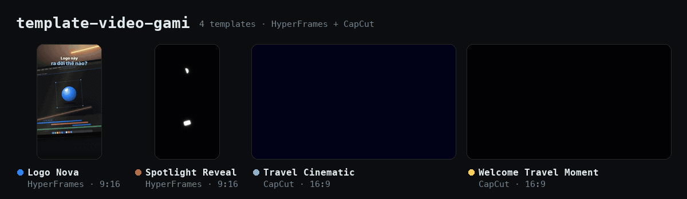
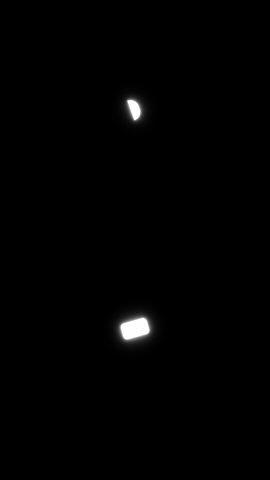
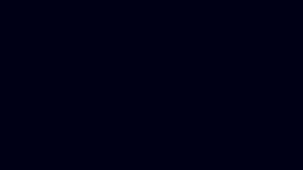
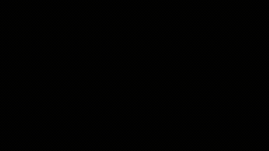
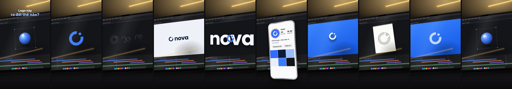
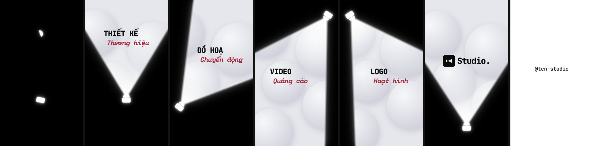
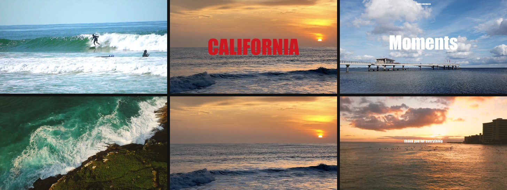
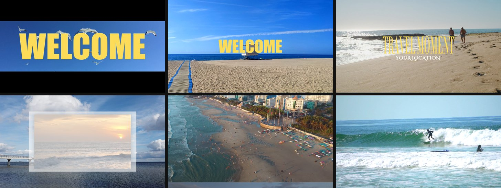

# Template Video Gami: gallery template

Bộ template video dựng lại từ các reel mẫu: phân tích từng khung hình, rồi dựng lại **bố cục, nhịp cắt, chuyển động và kiểu chữ**.
Không dùng lại video, nhạc hay đồ hoạ của tác giả gốc.

Có hai loại:

- **HyperFrames:** video bằng HTML + GSAP, sửa trong Studio, render ra MP4.
- **CapCut Desktop (macOS):** script Python sinh draft CapCut 9.5, mở và sửa tiếp trong CapCut.

## Gallery



<table>
<tr>
<td align="center" valign="top" width="18%"><a href="logo_nova_916/"></a><br>🔵 <b>Logo Nova</b><br><sub>HyperFrames · 9:16 · 18,8 s</sub></td>
<td align="center" valign="top" width="18%"><a href="spotlight_916/"></a><br>🔴 <b>Spotlight Reveal</b><br><sub>HyperFrames · 9:16 · 11,5 s</sub></td>
<td align="center" valign="top" width="32%"><a href="travel_cinematic/"></a><br>🟢 <b>Travel Cinematic</b><br><sub>CapCut · 16:9 · 22,5 s · 14 clip</sub></td>
<td align="center" valign="top" width="32%"><a href="welcome_travel/"></a><br>🟡 <b>Welcome Travel Moment</b><br><sub>CapCut · 16:9 · 25,5 s · 52 clip</sub></td>
</tr>
</table>

| Template | Loại | Khung · độ dài | Cách hoạt động |
|---|---|---|---|
| 🔵 **[Logo Nova](logo_nova_916/)** | HyperFrames | 9:16 · 18,8 s | "Process reel": màn laptop mở phần mềm dựng, logo biến hình 3D → nét → chữ → mockup điện thoại → 11 biến thể, 2 cú lồi khỏi màn, cắt theo phách 115 BPM, kết lặp về khung đầu |
| 🔴 **[Spotlight Reveal](spotlight_916/)** | HyperFrames | 9:16 · 11,5 s | Đèn rọi tự lắp ráp, quét chùm sáng làm lộ 4 dịch vụ rồi logo và handle. Chữ mono kiểu công nghệ, chỉ dùng SFX |
| 🟢 **[Travel Cinematic](travel_cinematic/)** | CapCut | 16:9 · 22,5 s · 14 clip | Mở bằng dải dọc theo phách, chữ LOCATION đỏ, thẻ tiêu đề "Moments", montage theo beat 120 BPM, tông teal–cam |
| 🟡 **[Welcome Travel Moment](welcome_travel/)** | CapCut | 16:9 · 25,5 s · 52 clip | WELCOME đổi font từng nhịp, letterbox mở dần, tiêu đề Didone, khung lồng bật nấc, cuộn dọc, cắt theo phách 133 BPM |

<details>
<summary>Dải khung hình chính (ảnh tĩnh)</summary>

**Logo Nova**



**Spotlight Reveal**



**Travel Cinematic**



**Welcome Travel Moment**



</details>

_GIF Logo Nova và Spotlight chụp thẳng từ HyperFrames (`snapshot`, 12 fps). GIF hai template CapCut dựng gần đúng từ `draft_info.json`
(`gallery/capcut_anim.py`): clip chạy theo thời gian, có mask, fade, khép màn, loé sáng, tông teal–cam. Nhưng font CapCut
được thay bằng font có sẵn trên máy, và không có animation chữ chi tiết, nên mở trong CapCut mới thấy đúng hình. Cách dựng lại
GIF: xem [gallery/README.md](gallery/README.md)._

## Dùng nhanh

### HyperFrames

```bash
cd spotlight_916
npx hyperframes preview          # mở Studio, sửa chữ ở bảng Variables
npx hyperframes render -o renders/spotlight_916.mp4
```

Cần Node.js và Chrome. Phiên bản HyperFrames được ghim trong `package.json`. Chi tiết: [spotlight_916/README.md](spotlight_916/README.md).

### CapCut (macOS, CapCut Desktop 9.5)

```bash
python3.11 -m venv .venv && .venv/bin/pip install -r requirements.txt
.venv/bin/python travel_cinematic/make_placeholders.py      # clip màu giữ chỗ để xem bố cục
# ĐÓNG CapCut trước khi sinh draft
.venv/bin/python travel_cinematic/build_template.py --name "Da Nang Trip" \
    --clips c01.mp4 ... c14.mp4 --location "DA NANG" --music nhac.mp3
```

Mỗi template có README riêng, gồm bảng phân tích video gốc → cách dựng, các tham số, và cách khớp beat theo nhạc.
`travel_cinematic/draft_check.py` kiểm tra draft sau khi sinh. `tools/capcut-cli` (ghim bản 0.31.1) dùng để lint draft:
chạy `npm ci --prefix tools/capcut-cli` để cài.

## Cấu trúc

```
logo_nova_916/        HyperFrames: index.html + compositions/ (room, build, wordmark, popout, variants, glass, hook)
spotlight_916/        HyperFrames: index.html + compositions/ + assets/sfx/
travel_cinematic/     CapCut: build_template.py, beats.py (đo BPM), draft_check.py, stock/credits.tsv
welcome_travel/       CapCut: build_template.py (dùng chung write_draft, beats của travel_cinematic)
research/             Ghi chép phân tích reel mẫu + script đo khung hình (measure.py, tile.py, preview_draft.py)
gallery/              GIF, ảnh xem trước + script dựng (capcut_anim.py, make_gallery_gif.py)
tools/capcut-cli/     package.json ghim capcut-cli (chỉ dùng để lint)
playbook/             Sổ tay dựng video (kịch bản, TTS, phụ đề, SFX, loudness, HyperFrames, QA, lệnh ffmpeg)
BAO_CAO_CAPCUT_TEMPLATE.md   Ghi chép định dạng draft CapCut 9.5 macOS và cách sinh template
```

## Không có trong repo

| Thứ | Lý do | Lấy lại |
|---|---|---|
| 14 clip Pexels của bản demo | Giấy phép Pexels không cho đăng lại nguyên bản | `sh travel_cinematic/stock/download_stock.sh` (nguồn, tác giả ở `credits.tsv`) |
| 4 bài nhạc Mixkit, nhạc của Logo Nova | Giấy phép Mixkit Free cấm phân phối lại | Dùng nhạc của bạn (`--music`); Logo Nova: xem `logo_nova_916/assets/music/CREDITS.md` |
| Clip giữ chỗ | Tạo lại được | `make_placeholders.py` trong từng template |
| Video, khung hình reel mẫu | Nội dung của tác giả khác, chỉ dùng để phân tích | Xem link nguồn trong README từng template |

Bản demo `welcome_travel` trong README dùng `travel_cinematic/stock/*.mp4`. Hãy tải stock trước hoặc thay bằng clip của bạn.

## Giấy phép tài nguyên

- SFX trong `spotlight_916/assets/sfx/` và `logo_nova_916/assets/sfx/` lấy từ Pixabay (Pixabay Content License, dùng thương mại không cần ghi nguồn).
  `whoosh-b`/`whoosh-c` là bản đổi tốc độ của `whoosh.mp3`.
- Font: HyperFrames dùng JetBrains Mono, Space Mono, Inter, Poppins (Google Fonts, OFL). CapCut dùng font miễn phí có sẵn trong CapCut.
