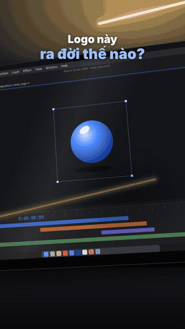

# Template "Logo Nova" 9:16 (HyperFrames)



Dựng lại ý tưởng reel "Logo animation concept" của The Odin ([phân tích](../research/reel_1377549584591197/BAO_CAO.md)).
Bản này chỉ giữ **ý tưởng, nhịp và cách dựng**. Logo "nova", giao diện phần mềm "Motion Studio", nhạc và SFX đều là
đồ dùng tạm hoặc làm mới, không lấy lại của tác giả.

- 1080×1920, 30 fps, 18,77 s = 36 phách nhạc 115 BPM. Khung cuối trùng khung đầu, nên Reels phát lại liền mạch.
- Màn laptop vẽ bằng CSS 3D (`.plane`), không cần quay thật.

## Diễn biến

| Thời điểm | Cảnh | Nội dung |
|---|---|---|
| 0–2,6 s | `hook` | Hook "Logo này / ra đời thế nào?" (có sẵn ở khung 0, làm ảnh bìa) |
| 0–4,17 s | `build` | Quả cầu 3D → mặt phẳng viền → con trỏ cắt chéo → vòng có khe + chấm → vệt sáng lướt |
| 4,17–10,43 s | `wordmark` | Logo đặc trên nền trắng → vẽ nét logo và chữ → đổ đặc → lockup xanh đậm |
| 10,43–12,53 s | `popout` | Chữ khổng lồ **lồi ra khỏi màn**, logo xoay 3D, chấm phồng thành avatar → điện thoại hiện trang mạng xã hội |
| 12,53–16,7 s | `variants` | 11 biến thể, cắt mỗi 1 / 0,5 / 0,26 s: vệt sáng, glow, nền xanh, chuyển sắc, phác nét, đen phẳng, sổ bút chì, icon app… |
| 16,7–18,77 s | `variants` | Về lại quả cầu + khung chọn = khung 0 → lặp |

Lớp nền `room` (tường, đèn LED, laptop, giao diện, đồng hồ timeline chạy theo thời gian video) và lớp kính `glass`
(loá, LED phản chiếu, bóng người) phủ suốt video. `popout` nằm trên lớp kính, nên phần lồi ra không bị phản chiếu.

## Sửa nội dung

| Biến | Mặc định | File |
|---|---|---|
| `hook1`, `hook2` | Logo này / ra đời thế nào? | `compositions/hook.html` |
| `brand` | nova | `compositions/wordmark.html`, `compositions/popout.html` |
| `posts`, `followers`, `bio`, `site` | 24 · 18,4K · Thiết kế gọn, nhận diện rõ · nova.studio | `compositions/popout.html` |

- Logo tạm là SVG (vòng có khe `stroke-dasharray="354.3 85.5"` + chấm) lặp lại trong `build`, `wordmark`, `popout`,
  `variants`. Thay logo thật thì thay các khối SVG đó.
- Góc nghiêng màn hình: khối `.plane` giống hệt nhau ở đầu mỗi file cảnh. Sửa một nơi thì sửa cả 6 nơi.
- Mốc cắt nằm trên lưới phách (1 phách = 60/115 s): `data-start` trong `index.html` và mảng `CUTS` trong `variants.html`.

## Âm thanh

- Nhạc "Summer Fun" (Mixkit), `data-media-start="0.4876"` để phách đầu của bài rơi đúng 0 s. **File nhạc không có trong
  repo** (giấy phép Mixkit cấm phân phối lại): cách lấy lại xem `assets/music/CREDITS.md`.
- SFX Pixabay (`assets/sfx/`): click lúc cắt, pop lúc thành vòng, whoosh + bass lúc chữ lồi ra, whoosh lúc điện thoại vào.

## Kiểm tra và render

```bash
cd logo_nova_916
npx hyperframes check
npx hyperframes snapshot --at 0,2.8,6.2,10.7,12,15.5,18.75
npx hyperframes render -o renders/logo_nova_916.mp4      # trên M1
hf-render-mbp -o renders/logo_nova_916.mp4               # trên mbp2016
```
