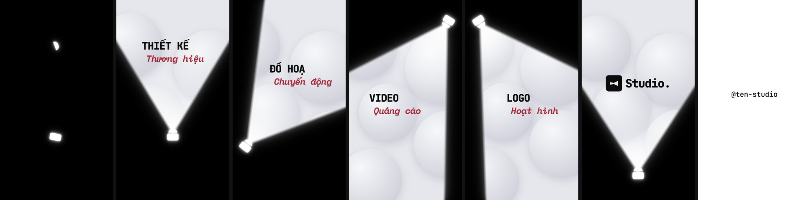

# Template "Spotlight Reveal" 9:16 (HyperFrames)



Dựng lại ý tưởng reel "Motion video" của Rj Design ([phân tích](../research/fb_14t4VadzQ7w/BAO_CAO.md)) cho khung dọc.
Bản này chỉ giữ **ý tưởng, nhịp và cách dựng**. Chữ, logo và âm thanh đều làm mới, không dùng lại đồ hoạ của tác giả.

- 1080×1920, 30 fps, 11,5 s, 2 cảnh (`compositions/spotlight.html`, `compositions/endcard.html`).
- Không có nhạc nền, chỉ có SFX (Pixabay, xem `assets/sfx/CREDITS.md`).

## Diễn biến

| Thời điểm | Hình | Tiếng |
|---|---|---|
| 0–1,05 s | Thân đèn phát sáng lắc lư, kính đèn rơi xuống nảy rồi khớp vào | pop |
| 1,05 s | Bật đèn, chùm sáng hắt lên: trạm 1 | click + sparkle |
| 2,35–7,2 s | 4 cú quét đổi góc: trạm 2 → 3 → 4 → logo | whoosh (3 bản cao/trầm khác nhau), whoosh dài + bass khi vào logo |
| 8,45–9,25 s | Chùm khép, đèn rơi khỏi khung, tấm trắng đẩy lên | click, whoosh |
| 9,1–11,5 s | Handle trượt vào, giữ ~2 s, thoát từng chữ | 4 tiếng tick |

## Sửa nội dung

Mở bằng `npx hyperframes preview` (Studio), sửa ở bảng **Variables**, hoặc sửa thẳng thuộc tính `default` ở đầu file cảnh.

| Biến | Mặc định | File |
|---|---|---|
| `s1a` / `s1b` … `s4a` / `s4b` | Thiết kế / Thương hiệu · Đồ hoạ / Chuyển động · Video / Quảng cáo · Logo / Hoạt hình | `compositions/spotlight.html` |
| `brand` | Studio. | `compositions/spotlight.html` |
| `accent` | `#A8283A` (màu dòng 2) | `compositions/spotlight.html` |
| `handle` | @ten-studio | `compositions/endcard.html` |

- Dòng 1 dùng JetBrains Mono 800, viết hoa. Dòng 2 dùng Space Mono nghiêng 700. Cả hai font có sẵn trong HyperFrames và có dấu tiếng Việt.
  Mỗi dòng nên dưới khoảng 11 ký tự để nằm gọn trong chùm sáng.
- Biểu tượng logo là SVG tạm trong `#sp-mark`. Thay bằng logo thật (`assets/…`).

## Tinh chỉnh chùm sáng

Trong `compositions/spotlight.html`:

| Muốn đổi | Sửa |
|---|---|
| Độ mềm mép chùm | `feather: 28` trong `const S` (20 sắc hơn, 40–70 mềm hơn) |
| Góc mở chùm | `spread: 31` (lúc bật đèn), `spread: 33` (lúc vào logo) |
| Vị trí, hướng đèn từng trạm | các dòng `swing(t, dur, { x, y, rot })` |
| Vị trí chữ từng trạm | `style="left: …; top: …"` của `#sp-t1` … `#sp-t4`, `#sp-logo` |
| Quầng sáng | `#sp-glow` (blur 30 px), `#sp-glow2` (blur 70 px, đục 0,4) |

Chùm sáng là mask của lớp "được rọi" (nền + chữ cố định). Mask gồm hai nửa mặt phẳng `linear-gradient` giao nhau, tính lại
mỗi khung trong `render()` từ trạng thái `S`, mà GSAP tween. Vì vậy tua tới lui vẫn ra đúng hình.

## Kiểm tra và render

```bash
cd spotlight_916
npx hyperframes check            # 0 lỗi
npx hyperframes snapshot --at 1.4,3.3,4.8,6.3,7.8
npx hyperframes render -o renders/spotlight_916.mp4
```

Sau khi render: đo âm lượng (`npx hyperframes audio renders/spotlight_916.mp4 --json`), chuẩn về khoảng −14 LUFS cho Reels.
